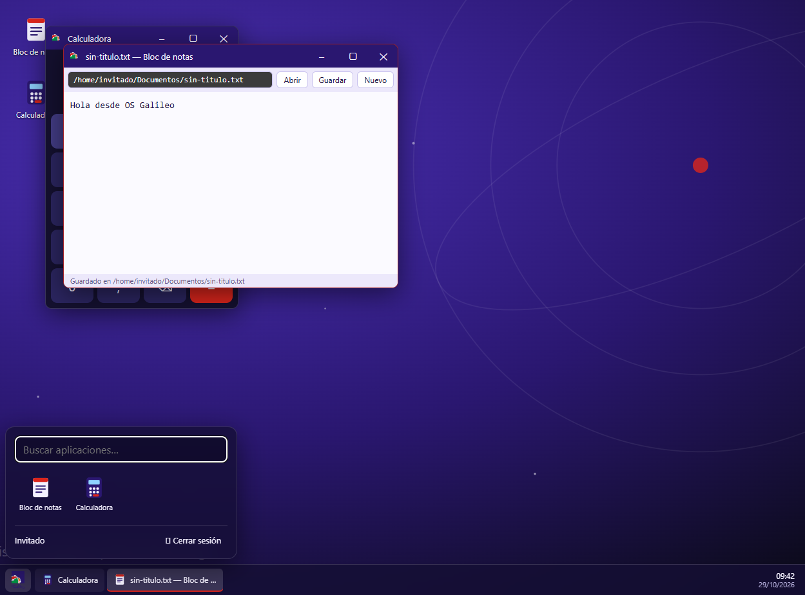
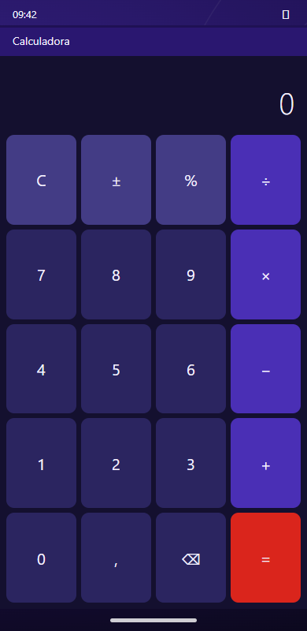

# OS Galileo

Sistema operativo **simulado** que corre en el navegador, para el alumnado del IES Galileo. Se publicará en la raíz de `iesgalileo.alejandrocatalaespi.es`.

## Objetivos
- Punto de entrada único a GASA, materiales y herramientas del curso.
- Aprender cómo funciona un SO (archivos, procesos, terminal, usuarios, permisos).
- Simulaciones de aplicaciones reales, sin instalar nada.
- Práctica de comandos y administración.
- Prueba de concepto de `ai-os` (SO para Raspberry Pi 5): los dos proyectos son independientes por ahora.

## Estado (v0.1)
- Arranque simulado y pantalla de acceso como **invitado** (sin cuenta).
- **Escritorio** con identidad Galileo (morado `#2a1770`, rojo `#da251c`): iconos, ventanas arrastrables, redimensionables, minimizables y maximizables, barra de tareas, menú de inicio con buscador y reloj.
- **Móvil** (< 760 px): cuadrícula de iconos, apps a pantalla completa, pulsación larga para reordenar (el orden se guarda).
- Núcleo: sistema de archivos virtual persistente (`localStorage`), procesos y registro de apps.
- Apps: **Archivos** (explorador: navegar, crear, renombrar, borrar, abrir con doble clic), **Terminal** (`help`, `ls`, `cd`, `cat`, `mkdir`, `touch`, `rm [-r]`, `mv`, `cp`, `tree`, `echo > / >>`, `ps`, `open`; historial con flechas y Tab), **Bloc de notas**, **Calculadora****PseudoFlow** y los juegos (**Sudoku**, **Binario**). GASA no se muestra por ahora; `apps/app-web.ts` permite añadirla (u otra web del mismo dominio) como app en una ventana.
- Fondos de escritorio en `public/fondos/` (`src/kernel/fondos.ts`): cambia en cada entrada y cada 10 minutos; para añadir más, copiar la imagen y listarla en `FONDOS`.

 

## PseudoFlow (`src/apps/pseudoflow/`)
Pseudocódigo y diagrama de flujo como **dos vistas del mismo modelo** (`modelo.ts`): se ven por separado o las dos a la vez, y lo que se hace en una aparece en la otra.
- **Pseudocódigo** (el de las diapositivas de Programación UT03 §1): `LEER`, `ESCRIBIR`, `x <- valor`, `SI…ENTONCES…SI NO…FIN SI`, `SEGÚN…CASO…OTRO…FIN SEGÚN`, `MIENTRAS…HACER…FIN MIENTRAS`, `REPETIR…HASTA`, `PARA…DESDE…HASTA…[CON PASO]…HACER…FIN PARA`. Resaltado de palabras clave, sangría automática y errores con su línea.
- **Listado lateral**: al pulsar una estructura se escribe en el cursor con huecos ‹…›; **Tab** salta al siguiente hueco y no se puede ejecutar hasta rellenarlos. Hay también fichas de operadores y funciones.
- **Diagrama**: óvalo, rectángulo, rombo y paralelogramo. Se edita con el **+** de cada flecha (añadir), pulsando un símbolo (editar sus campos, subir, bajar, eliminar). Como es estructurado, una decisión siempre tiene dos salidas que se reúnen: no puede haber ramas colgando. El pseudocódigo se regenera solo.
- **Ejecutar** (trazado): paso a paso o automático, símbolo y línea resaltados, tabla de variables, salida y entrada con `LEER`. Detecta división entre cero, variables sin valor, comparar texto con número y bucles infinitos (20 000 pasos).
- **Archivos**: guardar/abrir en el sistema virtual (`.psc` texto, `.diag` XML), descargar **TXT**, **PNG** (fondo blanco, sin botones) y **XML**, e importar TXT/XML.
- Ejemplos de la UT03 §1: aprobado/suspenso, tres rangos, notas hasta −1, traza de `x`, tabla con `PARA`, `REPETIR`, `SEGÚN`.
- Los casos de un `SEGÚN` solo se editan en el pseudocódigo (en el diagrama se ven como una cadena de decisiones).
- **Subprocesos:** `SUBPROCESO Nombre … FIN SUBPROCESO` y se llaman escribiendo su nombre. Cada uno tiene su diagrama en una pestaña (empieza con su nombre y acaba en «Volver») y se pueden crear desde «+ Subproceso». El trazado salta al subproceso.
- **Texto libre** (casilla «Texto libre»): una línea que no es una instrucción es una acción en lenguaje natural («Coger el cepillo») y una condición como «la tierra está seca» se pregunta al ejecutar («¿Se cumple? Sí / No»). Fuera de este modo una errata sigue dando error.
- **Dialecto propio, solo el del departamento.** No se admite el estilo PSeInt (`Algoritmo`, `SiNo`, `Hasta Que`…). Los huecos de los fragmentos del listado se escriben `‹así›` (no `«»`, que se usan en los textos libres).

### Ejercicios de PseudoFlow
Botón «📚 Ejercicios»: **75 ejercicios de «Pensar antes de programar»** (serie de apuntes de un compañero) ordenados por dificultad (Base 27 · Medio 32 · Avanzado 16), con filtros por bloque (10) y por tipo (diseño, traza, error, traducción, razona). Cada uno abre una tarjeta con enunciado, datos de prueba y pista (oculta hasta pedirla); el editor se carga con el código de partida si lo hay y guarda el borrador de cada ejercicio.
- **Comprobar** ejecuta el algoritmo del alumno con los datos de prueba y revisa lo que escribe (números, textos, en orden) y la forma (`Estructura`: usa/no usa tal estructura, subprocesos, orden de pasos…). Dice qué datos fallan y por qué, pero **nunca muestra la solución**.
- Traza y razona: respuestas cortas, verdadero/falso o texto razonado. Traducción: «Ver diagrama del enunciado» dibuja el diagrama y el alumno escribe el pseudocódigo. Los ejercicios con dos versiones (7.4, 7.9, 5.2, 10.3) tienen una pestaña por versión.
- El progreso (✓) y los borradores se guardan en el navegador (`localStorage`); con cuentas de alumnado pasará a la base de datos.
- Datos en `ejercicios.ts`, corrector en `comprobar.ts`, interfaz en `ejercicios-ui.ts`. Las soluciones del compañero (Parte 3 de sus apuntes) **no están en el repositorio**: se usaron fuera de él para validar los 75 ejercicios (las 282 pruebas las superan y los 4 ejercicios de corrección fallan con su código inicial).

## Desarrollo
```
npm install
npm run dev      # servidor de desarrollo
npm run build    # tsc + vite build → dist/
```
`dist/` es estático y usa rutas relativas: se publica copiándolo a la raíz del subdominio.

## Juegos (`src/apps/juegos/`)
Carpeta **Inicio → Aplicaciones → Juegos** con juegos educativos.
- **Sudoku** (`sudoku/`): tableros **4×4** (cajas 2×2) y **9×9** (3×3), cuatro niveles (Fácil, Medio, Difícil, Experto). Todos los tableros tienen **solución única**; Fácil y Medio se resuelven solo con «únicos» (candidato único y único lugar posible) y Difícil/Experto dejan menos pistas (9×9: 42 · 34 · 28 · 24). Resaltado de fila, columna, caja y número igual; **marcar repetidos**; **Comprobar** (marca lo que no coincide con la solución); deshacer y rehacer (Ctrl+Z / Ctrl+Y); teclado numérico en pantalla y teclado físico con flechas; temporizador y **estadísticas** (ganadas, mejor tiempo y media por tamaño y nivel). Guarda la partida en curso y las estadísticas en el navegador.
- El generador (`generador.ts`) usa un resolutor con *backtracking* y la casilla con menos candidatos primero: el mismo algoritmo que puede acabar siendo un ejercicio de programación.
- **Binario** (`binario/`), con tres modos:
  - **Bombillas:** ocho (o cuatro) bombillas con su valor (128, 64… 1). Retos de *formar un número* y de *leer el número* que muestran; niveles Fácil (4 bombillas con la suma a la vista), Medio (8 con suma) y Difícil (8 sin suma). Racha y mejor racha.
  - **Pruebas rápidas:** rondas de 10 preguntas cronometradas de decimal ↔ binario (4 u 8 bits) y, en Difícil, hexadecimal; se compara el valor, así que no hace falta rellenar con ceros. Guarda la mejor ronda por nivel.
  - **Puertas lógicas:** se elige AND, OR, XOR, NAND o NOR en cada hueco de una fórmula (con `NO` fijos) para que la salida coincida con la tabla de verdad esperada; la tabla indica en vivo qué filas fallan. Tres niveles (2, 3 y 4 entradas) con circuitos generados al azar y siempre con solución.
- Pensado para añadir **control por el profesorado** (activar o desactivar la carpeta por grupo o franja horaria) cuando haya cuentas de alumnado; hoy no hay ninguno.

## Menú Inicio (escritorio)
Las aplicaciones del sistema (Archivos, Terminal, Bloc de notas, Calculadora) están en el escritorio y en el menú. Las de cada módulo están en **Inicio → Aplicaciones → módulo** (submenú en cascada); se declaran con `carpeta: "0485 · Programación"` en su `AppDef` (los juegos usan `carpeta: "Juegos"`) y la búsqueda las encuentra todas. En el móvil siguen todas en la pantalla de inicio.

## Arquitectura (`src/`)
- `kernel/vfs.ts` — árbol de archivos y carpetas (`leer`, `escribir`, `listar`, `mkdir`, `borrar`). Interfaz preparada para migrar a IndexedDB.
- `kernel/kernel.ts` — usuario, procesos y registro de apps (`AppDef`: `id`, `nombre`, `icono`, tamaño e `iniciar(ctx)`).
- `shell/escritorio.ts` y `shell/movil.ts` — dos «shells» sobre el mismo núcleo; `main.ts` elige uno según el ancho.
- `shell/arranque.ts` — arranque y acceso.
- `apps/` — una app por fichero. Para añadir una: exportar un `AppDef` y registrarlo en `main.ts`.

## Hoja de ruta
1. Logo definitivo en el arranque.
2. Terminal: tuberías, permisos y usuarios; explorador: mover/copiar arrastrando.
3. Acceso real: correo del alumno + código por correo, altas y apps por módulo en una base de datos administrada (como el panel del profesorado).
4. Simulaciones de aplicaciones (IDE, bases de datos, redes…) y procesos, permisos y usuarios.
